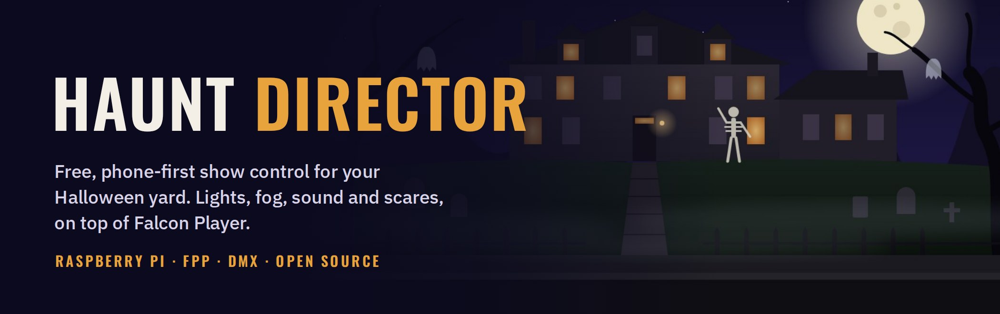
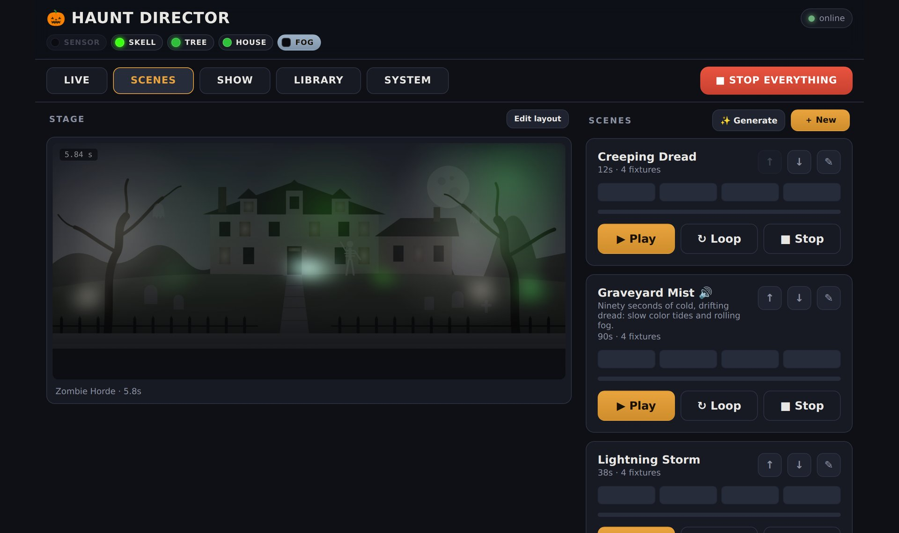
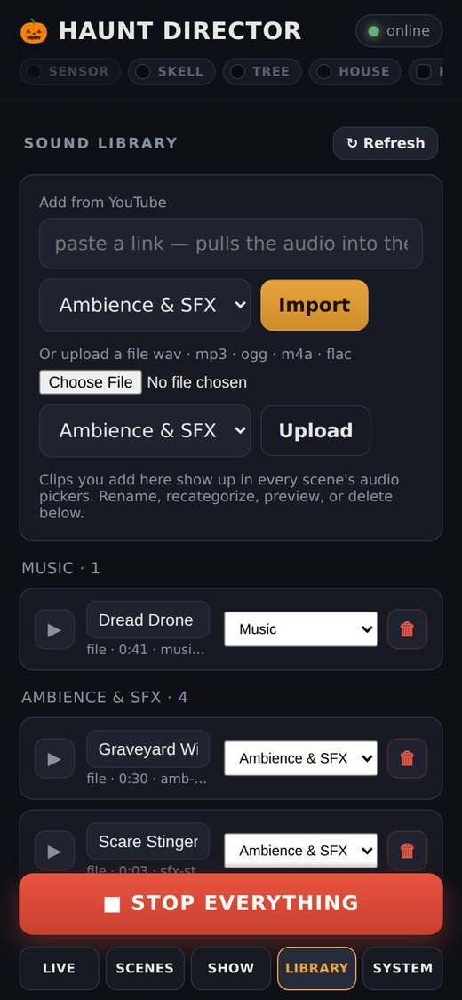
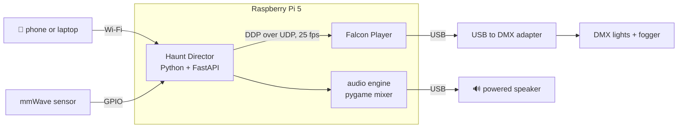

<p align="center">
  
</p>

<p align="center">
  <b>A Raspberry Pi, a few DMX lights, a fog machine and a speaker, turned into a yard that reacts when people walk up.</b><br>
  Spooky in October. Merry in December. Red, white and blue whenever you feel like it.
</p>

<p align="center">
  <a href="#quick-start">Quick start</a> ·
  <a href="#what-it-costs">What it costs</a> ·
  <a href="docs/hardware.md">Hardware</a> ·
  <a href="docs/using-it.md">Tour</a> ·
  <a href="docs/safety.md">Safety</a> ·
  <a href="docs/troubleshooting.md">Help</a>
</p>

---

## Hi! 👻

**Haunt Director** is a free, open source show controller for your front yard. You design scenes on your phone, arm the show, and go hand out candy. When someone walks up the path, the yard notices.

It started as a Halloween project, which explains the name, the fog, and the number of skeletons in the screenshots. It also started as "I just want the lights to glow red when someone walks up" and ended with a beat tracker, a 25 frames per second output bus and a test suite. That's how these things go. We regret nothing.

Under the hood it runs next to [Falcon Player (FPP)](https://github.com/FalconChristmas/fpp), the engine the Christmas light community has trusted for years to push channel data out to real hardware. FPP drives the lights. Haunt Director handles everything else (scenes, timing, sound, the presence sensor, schedules and the safety rails) from one friendly app that runs in the browser on the phone already in your pocket.

No subscription. No cloud account. No login. Just your Pi, on your network.

## What it does

- 🎨 **Scenes you can build in an evening.** A timeline editor with a lane for every light, the fogger and your sound. Fades, pulses, strobes, blackouts and fog bursts, previewed on a picture of your own house before anything happens in the yard.
- 🧟 **A show that runs itself.** Arm it at dusk (or let the schedule do it) and it rotates moody ambient scenes with smooth audio crossfades. When the presence sensor spots someone, it fires a scare, then drifts back to ambient after a cooldown. Or go sensor-only: the yard waits, dark and silent, until someone gets close.
- 🏡 **House lights for every other night.** Give each light one to four colors and it glides slowly between them, a little out of step with its neighbors, on a dusk-to-bedtime schedule of its own. Lights only, never fog or sound. The show takes over whenever it's armed and hands the house back afterwards.
- 🔊 **Real sound, mixed on the Pi.** Music beds, voice lines and sound effects in one mixer, kept in time with the lights. Voices automatically duck the music so your "welcome, mortals" actually lands. Master volume, a light-timing nudge and Test buttons included.
- 🎸 **Song shows.** Give it a song and the drums, bass and guitar each drive a light, while the meaning of the lyrics picks the colors for each section. Only timings and colors are saved, never the words.
- ✨ **AI scene drafts.** Describe a scene in plain words and get a first draft to tweak. Song shows and drafts are optional and use your own AI key.
- 🩺 **A System tab that fixes things.** Live health for FPP, the lights, sound, sensor and the Pi, plus a setup checklist where most problems have a one-tap **Fix**. Restart and reboot from your phone, in the yard, in the dark.
- 🛡️ **Safety rails, not suggestions.** Fog bursts can't outlive their cap, one master switch holds the fogger at zero, there's an optional cap on strobe speed, and if the app ever stops, the lights go dark within a second instead of freezing on. Plus a big red **STOP EVERYTHING** button.

<p align="center">
  
</p>

<p align="center">
  
  
  
  
</p>

## Not just for Halloween 🎄

Halloween is home turf. But a Pi that can paint your house any color, on a schedule, with optional sound and a sensor, doesn't much care what's on the calendar.

- 🎃 **Halloween.** The full treatment: fog, scares, ambient dread, a sensor that knows when trick-or-treaters reach the porch, and a schedule that winds things down before the neighbors start drafting emails.
- 🎄 **Christmas.** House lights in red, green and warm white from dusk to 11 pm every night, with no plug-in timer to forget. A scene with sleigh bells and a booming "ho ho ho" when someone walks up (carolers, the mail carrier, a confused raccoon). Song shows work with holiday music too, as long as you have the rights to use it.
- 🎆 **The rest of the year.** Red, white and blue for the Fourth. Green for St. Patrick's Day. Blue and white for Hanukkah, warm golds for Diwali, red and gold for Lunar New Year, pink for Valentine's Day, your team's colors on game day, and somebody's favorite color on their birthday. If it has colors, your house can wear them.

Fair warning: the example scenes lean spooky. You may want to rename "Zombie Horde" before the in-laws arrive for Christmas dinner.

## Why bother?

- 👨‍👩‍👧 **It's a family project.** The kids can design a scene on a tablet, preview it on the picture of the house, then go outside and watch it scare the dog. Expect at least one teenager who calls the whole thing lame and then "tests the sensor" six times.
- 🏘️ **It's a neighborhood thing.** The yard that reacts becomes a stop on the trick-or-treat route. Little ones get the gentle ambient version from the sidewalk; the brave ones walk up the path and find out. (There's a [Safety](docs/safety.md) page about strobes, fog and cables, because the goal is screams of delight, not a trip to urgent care.)
- ⏰ **It's set and forget.** House lights follow a dusk schedule, so the house looks good every night without anyone remembering anything. The show can arm itself on its own schedule too.
- 📱 **It's fixable from the porch.** Something looks off at 7 pm? Fix it on the phone in one hand while the other holds the candy bowl.
- 🌱 **It grows with you.** Start with a few lights this year and add sound, fog and a sensor next year. Nothing you buy early gets thrown away later.

## Under the hood ⚙️

For the curious, and for the people who will open an issue about frame timing (bless you):



- **One writer, one output bus.** A dedicated thread with a fixed-deadline clock builds every frame from layers in a strict order: the fog guard, then anything you set by hand on Live, then the playing scene, then house lights, then idle. Nothing gets around the fog guard.
- **DDP into FPP.** Haunt Director never talks to the DMX adapter itself. Each frame goes to FPP as one UDP datagram, and if frames stop arriving, FPP lets go of the channels within a second and everything goes dark. That's the dead-man switch: a crashed app can't leave the fogger running.
- **Fog is guarded on the Pi.** Every burst carries its own deadline and expires on the Pi, so a phone that drops off Wi-Fi mid-burst doesn't matter.
- **Sound is mixed on the Pi.** One in-process mixer with 16 channels drives a USB audio adapter directly. Scare sounds are loaded into memory at startup so a trigger never waits on the SD card, and a light-timing offset (-300 to +300 ms) lines the lights up with your speaker.
- **Song shows are real signal processing.** ffmpeg splits the song into five frequency bands, a dynamic-programming beat tracker (Ellis, 2007) follows the drummer's actual tempo, and timed lyrics from LRCLIB mark the sections. The AI just picks the palette.
- **House lights run on the wall clock.** The color drift is a pure function of the time, so the Pi, the preview on your phone and the dot on each card always agree. A golden-ratio phase offset keeps neighboring lights from changing together, and dusk is worked out from your location.
- **Fixtures are data.** Each light model is a small JSON profile: which channel is red, which is strobe, and which ranges to avoid so a cheap PAR never wanders into its built-in "auto disco" mode in the middle of a scare.
- **Tested without hardware.** The test suite swaps the DMX path for a recording transport, so it runs anywhere, including CI. Anything touching fog, strobe, the output bus or STOP needs a test. No exceptions.
- **Light on its feet.** On the reference Pi, the whole stack (FPP, Haunt Director and the desktop) uses about 1 GB of RAM.

The [How it works](docs/how-it-works.md) page goes deeper.

## What it costs

The software is free. The hardware is where your wallet gets spooked. Here are four ways in, from "free" to "the neighbors have started bringing guests":

| Tier | What you get | Roughly |
|---|---|---|
| 🧪 **Test drive** | The app on your laptop: scenes, the editor, the house simulator and the sound library. No lights yet, but you'll know if you like it ([how](CONTRIBUTING.md#development-setup)) | **$0** |
| 🕯️ **Porch Light** | A Pi and four indoor DMX lights kept under cover (the porch, the eaves, inside the front windows). House lights on a schedule, Live control and full light scenes. No sound, fog or scares | **about $325** |
| 🎃 **Front Yard Fright** | Roughly the reference rig: weatherproof lights out in the yard, sound, a DMX fogger and a presence sensor. Everything on this page works | **about $650 to $1,000** |
| 🦇 **Neighborhood Legend** | More lights (6 to 10), low-lying or name-brand fog, a proper PA speaker, an isolated DMX adapter and a wired network | **$1,500 and up** (mostly up) |

And here's where those numbers come from:

| Item | Tier | Typical price | Notes |
|---|---|---|---|
| Raspberry Pi 5, 4 GB | 🕯️ 🎃 🦇 | about $110 | The reference rig has the 8 GB model (about $175), but the whole stack uses about 1 GB, so 4 GB should be plenty (untested) |
| Official 27 W USB-C power supply | 🕯️ 🎃 🦇 | $12 to $15 | Under-voltage shows up as weird USB problems, and your DMX and sound are both USB |
| Case with a fan | 🕯️ 🎃 🦇 | $10 to $15 | |
| microSD card, 64 GB or more, from a name brand | 🕯️ 🎃 🦇 | $15 to $40 | Your audio is the only thing that takes real space. Keep a backup image |
| USB to DMX adapter | 🕯️ 🎃 🦇 | $20 to $40 generic, about $72 ENTTEC | Tested: ENTTEC Open DMX USB. Generic cables with a genuine FTDI chip work the same way in FPP (untested here) |
| 3-pin DMX cables and a terminator | 🕯️ 🎃 🦇 | about $30 for two 25 ft cables, $11 terminator | The terminator fixes a surprising amount of flicker |
| Indoor RGBW DMX PAR lights | 🕯️ | about $100 for four | Not waterproof. Keep them dry |
| Outdoor (IP65) RGBW DMX PAR lights | 🎃 🦇 | $90 to $110 each, $450 and up for name brands | Tested: HOLDLAMP IP65 RGBW in 8 channel mode. Other fixtures need a small [profile](docs/fixture-profiles.md) |
| DMX fog machine | 🎃 🦇 | $60 to $150; $260 to $300 low-lying; about $400 name brand | It needs a DMX input. A 1-channel fogger works as is; foggers with built-in LEDs need a profile |
| USB audio adapter | 🎃 🦇 | $10 to $16 | The Pi 5 has no headphone jack. Any class-compliant adapter should do |
| Powered speaker with a wired input | 🎃 🦇 | $40 to $200 | AUX, RCA or line in. Bluetooth adds lag and is untested |
| HLK-LD2410B mmWave presence sensor | 🎃 🦇 | $5 to $8 | Wires straight to the Pi. On the reference rig it lives in a pill bottle wrapped in self-fusing tape and sees right through it |
| Cat5/6 cable and RJ45 screw terminals | 🎃 🦇 | about $15 | For running the sensor out to the path |
| Weatherproof box for the Pi and power | 🎃 🦇 | $20 to $30 | Plus GFCI outlets and outdoor-rated cords |
| Things you probably already own | all | $0 | A phone, Wi-Fi, extension cords, and ideally one enormous skeleton |

> 💸 Prices are rough US street prices from October 2026, and they move. A memory shortage pushed Raspberry Pi and SD card prices up sharply this year, so check before you buy. [What you need](docs/hardware.md) has the full list, the exact tested gear and the wiring.

## Quick start

> You'll need a Pi that already runs FPP. If you haven't set that up yet, start with [Install](docs/install.md#1-install-fpp). It takes about 20 minutes.

```bash
# on the Pi, as your normal user
git clone https://github.com/phonoodlesramen/haunt-director.git
cd haunt-director
./deploy/install.sh
```

Then open **`http://<your-pi>:8000`** on your phone and:

1. 🩺 Go to the **System** tab. Anything red or yellow has a **Fix** button or a hint. Tap until it says *"Your rig is ready to haunt."*
2. 💡 On **Live**, try a color on each light. If the wrong light responds, fix the addresses (see [Install, step 5](docs/install.md#5-tell-it-about-your-rig)).
3. 🔊 On **Show → Output**, press **Test** for sound and for fog.
4. 🎬 Play an example scene from **Scenes**, then press ✎ to see how it's built.
5. 🎃 Arm the show. Walk past your sensor. Scream a little.
6. 🏡 Not show night? Set up **House lights** at the top of Live and let the house glow on its own.

The full walkthrough is in [docs/install.md](docs/install.md).

## The docs

| | |
|---|---|
| 🧰 [What you need](docs/hardware.md) | Equipment by tier with prices, the exact tested gear, wiring, DMX addressing |
| 🛠️ [Install](docs/install.md) | FPP, Haunt Director, first-run setup, updating |
| 🗺️ [Tour](docs/using-it.md) | Every tab, the editor, show mode, house lights, sound, the System tab |
| 💡 [Fixture profiles](docs/fixture-profiles.md) | Teach it a new light in one small JSON file |
| ⚙️ [How it works](docs/how-it-works.md) | The output bus, DDP, the audio engine, the safety layers |
| 📏 [Limits and unknowns](docs/limits-and-unknowns.md) | Recommended limits, what's untested, known quirks |
| 🦺 [Safety](docs/safety.md) | Strobes and photosensitivity, fog, outdoor power |
| 🩹 [Troubleshooting](docs/troubleshooting.md) | Real problems we hit and how they were fixed |
| 🔐 [Security](SECURITY.md) | Trusted network only. Why, and how to reach it remotely |
| 🤝 [Contributing](CONTRIBUTING.md) | Dev setup, project layout, wanted: your fixture profiles |
| 📝 [Changelog](CHANGELOG.md) | What's new |

## Honest status

This is version **0.1** plus a growing pile of improvements, built for one real front yard and tested hard on that one rig in the run-up to Halloween 2026. It works well there. House lights are brand new, and the Christmas ideas above are exactly that, ideas: it's October, and nobody has hung a wreath on this thing yet. Your Pi, fixtures and Wi-Fi will be different, so expect some rough edges. The [limits and unknowns](docs/limits-and-unknowns.md) page lists what is and isn't proven, and [issues](https://github.com/phonoodlesramen/haunt-director/issues) are very welcome. "It works on my Pi 4" counts as a contribution.

## A note on audio

The repo ships with five placeholder sounds that were synthesized from scratch for this project and are dedicated to the public domain (CC0). Bring your own audio for the real show. The Library can import from YouTube (via [yt-dlp](https://github.com/yt-dlp/yt-dlp)), but **only use audio you have the right to use**. That goes double for holiday music: the song you hear in every store in December is still somebody's song. There are plenty of free, properly licensed sound effects out there, spooky and jolly alike.

## Thanks

To the [Falcon Player](https://github.com/FalconChristmas/fpp) developers and community, whose work does the heavy lifting here. Haunt Director isn't affiliated with or endorsed by the FPP project, and their support channels aren't the place for Haunt Director questions. Please [open an issue here](https://github.com/phonoodlesramen/haunt-director/issues) instead.

## License

[MIT](LICENSE). Use it, fork it, scare people with it. Or deck the halls with it. 🎃🎄
