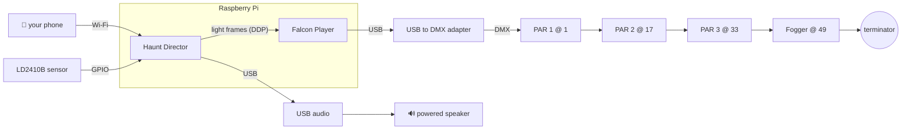

# 🧰 What you need

Haunt Director is deliberately small: one Pi, one DMX cable, a handful of fixtures. Here's the shopping list, the exact gear it was tested with, and how it all plugs together.

> **Legend:** ✅ tested on the reference rig · 🤞 should work, untested · ❌ known not to work

## The shopping list

### Required

| Item | Why | Notes |
|---|---|---|
| **Raspberry Pi** | Runs FPP and Haunt Director | ✅ Pi 5 (8 GB). 🤞 Pi 4. See [unknowns](limits-and-unknowns.md#unknowns) for others |
| **Official Pi power supply** | Stops brown-outs and odd USB behavior | The Pi 5 wants the 27 W USB-C supply. The System tab warns you if it sees under-voltage |
| **microSD card** (32 GB+) | OS, FPP, your audio | ✅ 128 GB. Audio is the only thing that takes real space |
| **Falcon Player (FPP)** | Talks to the DMX hardware | ✅ FPP 9.5. See [Install](install.md#1-install-fpp) |
| **USB to DMX adapter** | Turns USB into a DMX signal | ✅ ENTTEC Open DMX USB (FTDI FT232R) as FPP `DMX-Open`. 🤞 anything FPP supports, like `DMX-Pro` adapters |
| **DMX fixtures** | The lights! | ✅ HOLDLAMP IP65 RGBW PAR, 8 channel mode. Others need a [profile](fixture-profiles.md) |
| **DMX cables + a terminator** | Daisy-chain the fixtures | 3-pin XLR is typical for these lights. Put a 120 Ω terminator in the last fixture's DMX OUT |
| **A phone or laptop** | Running the app | Any modern browser on the same network |

### Optional, but they're the fun part

| Item | Why | Notes |
|---|---|---|
| **DMX fog machine** | Rolling fog, timed bursts | ✅ a 1-channel DMX fogger. Any fogger with a DMX "output" channel |
| **USB audio adapter** | Sound out of the Pi | ✅ Griffin iMic. 🤞 most class-compliant USB audio adapters. The Pi 5 has **no** headphone jack |
| **Powered speaker** | So the neighbors can hear the zombies | Anything with a line or AUX input. Outdoor rated if it lives outside |
| **Presence sensor** | Fires scares when someone walks up | ✅ HLK-LD2410B 24 GHz mmWave (digital OUT). 🤞 a PIR or any active-high 3.3 V output |
| **Cat5/6 cable + RJ45 screw-terminal adapters** | Running the sensor a long way from the Pi | ✅ what the reference rig uses to reach the porch |
| **Static RGB spotlights** | Fill light | Not controllable (no DMX). The app can still show them in the simulator so your preview matches the yard |
| **Big props** | Atmosphere | A giant yard skeleton looks fantastic lit from below. Props with their own electronics just stay independent |
| **Tailscale** (or another VPN) | Checking on the show from anywhere | ✅ free tier. See [Security](../SECURITY.md) |

## The reference rig (exactly what this was tested with)

| Part | Details |
|---|---|
| Computer | Raspberry Pi 5 Model B Rev 1.1, 8 GB RAM, 128 GB microSD |
| OS | Raspberry Pi OS (Debian 12 "Bookworm"), 64-bit, kernel 6.12 |
| FPP | 9.5, installed on top of Raspberry Pi OS with FPP's install script |
| Python | 3.11.2, packages as pinned in `backend/requirements.txt` |
| DMX adapter | ENTTEC Open DMX USB (FTDI FT232R), FPP output `DMX-Open` on `/dev/ttyUSB0` |
| Lights | 3 × HOLDLAMP IP65 RGBW PAR in 8 channel mode at DMX 1, 17 and 33 |
| Fog | 1-channel DMX fogger at DMX 49 |
| Audio | Griffin iMic USB audio adapter into a powered outdoor speaker |
| Sensor | HLK-LD2410B, OUT on GPIO 4 (BCM), powered from the Pi's 5 V pin, run out to the porch over Cat5 |
| Network | Pi on Wi-Fi (about -62 dBm at the porch), Tailscale for remote access |
| Extras | 2 static solar RGB spotlights, one 12-foot yard skeleton |
| Browsers | Phone and desktop browsers on the same Wi-Fi, plus over Tailscale |

## Wiring it up

### DMX

1. Chain the adapter's output to fixture 1's **DMX IN**, then fixture 1's **OUT** to fixture 2's **IN**, and so on.
2. Put a **terminator** in the last device's OUT. It's a tiny plug and it fixes a surprising amount of flicker.
3. Set each fixture's **address** on its little display (usually MODE/UP/DOWN/ENTER). Leave gaps so you can change modes later without re-addressing everything:

| Device | Address | Reserved |
|---|---|---|
| Light 1 | 1 | 1 to 16 |
| Light 2 | 17 | 17 to 32 |
| Light 3 | 33 | 33 to 48 |
| Fogger | 49 | 49 to 64 |

4. Put every light in the **same channel mode** your profile describes (the reference HOLDLAMPs use 8 channel mode: dimmer, red, green, blue, white, strobe, function, speed).

> 💡 **Tip:** in FPP's DMX output settings, set the channel count to just past your last fixture (64 above) instead of 512. Each DMX frame gets about eight times shorter, so cheap adapters with no frame buffer of their own stay smoother. The System tab suggests this when it applies.

> ⚠️ The ENTTEC Open DMX USB and its clones are **not electrically isolated**. The Pi's ground goes out along the DMX cable into a damp yard. It worked fine on the reference rig, but keep connections dry and see [Safety](safety.md#outdoor-power-and-water). Isolated adapters cost more and remove the worry.

### Presence sensor (LD2410B)

| Sensor pin | Pi pin | Notes |
|---|---|---|
| VCC | 5 V (pin 2 or 4) | The module wants 5 V |
| GND | GND (pin 6) | |
| OUT | a free GPIO, e.g. GPIO 4 (pin 7) | 3.3 V logic, HIGH when someone is there. Set the pin number under **Show → Presence sensor** |
| TX / RX | not connected | Only used for configuring it from a computer |

- A small **series resistor (about 1 kΩ)** on OUT costs nothing and protects the Pi from a wiring slip.
- Long run? Use a spare Cat5/6 cable with **RJ45 screw-terminal adapters** at each end. Put power, ground and OUT on separate pairs, each paired with a ground.
- Configure the sensor's range and sensitivity with the maker's Bluetooth phone app, then **turn its Bluetooth off** for the show. Radar sees *motion*, not people: swinging props, blowing fabric and fog plumes can all trigger it. Aim it along the path, not at the decorations. On the reference rig it faces the approach path and away from the yard props.
- On a Pi 5 some pins are claimed by other functions on certain OS versions. If your pin doesn't read, try another free GPIO (17, 22, 23, 24, 25, 27 are common choices).

### Audio

Plug the USB adapter into the Pi and its output into a powered speaker. Then, in the app, open **System**. If the Pi is defaulting to its HDMI port (it often does when no monitor is attached), the Sound check offers a one-click fix that points audio at your USB adapter.

Set the speaker's own volume once, sensibly loud, and ride the level from the app's **Volume** slider after that. A little less bass and a little more mid-range on the speaker helps voices cut through outdoors.

## Power and placement

- Use the official supply. Under-voltage on a Pi 5 shows up as random USB weirdness first (your DMX adapter and sound card are both USB).
- Give the Pi a ventilated, weatherproof box. The System tab shows temperature and warns about heat throttling.
- Wi-Fi at the porch matters. The reference rig runs fine around -62 dBm. A weak signal makes boots slower (see [Troubleshooting](troubleshooting.md#the-app-says-fpp-offline-after-a-reboot)). Wired Ethernet is even better.
- Give the Pi a **fixed address** on your router (a DHCP reservation) so the app is always at the same URL.
