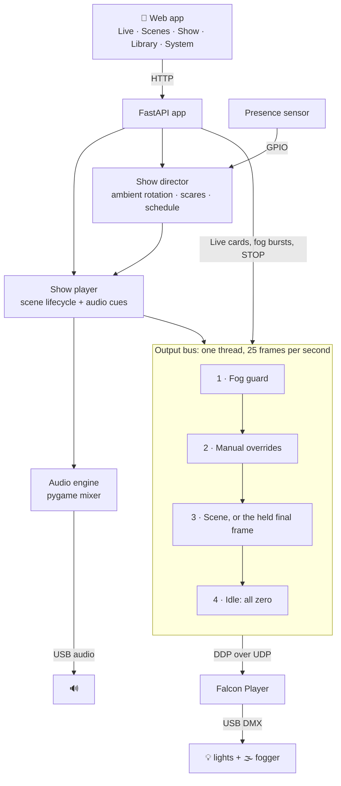

# ⚙️ How it works

A short tour under the hood, for the curious and for contributors.

## The big picture



**FPP does what it's great at:** talking to DMX hardware reliably. **Haunt Director does everything else:** timing, show logic, sound and safety. It renders the show live, frame by frame, instead of exporting sequence files, so a scene can start the instant someone walks up, a Live card can override one light mid-scene, and STOP means stop.

## The output bus

All light and fog output goes through **one writer**: the output bus (`backend/haunt_director/output.py`). It's a single thread with its own deadline clock that composes a **complete frame** every 40 ms from layers, highest priority first:

1. **Fog guard.** If fog output is switched off, the fog channel is zero. Nothing outranks this.
2. **Manual overrides.** Live cards and fog bursts. Fog bursts carry an expiry time, and the bus drops them on the first frame past it, so a burst can't outlive its cap even if the request that started it vanished.
3. **The scene.** The player hands the bus a function that evaluates the current scene at the shared clock. When a scene ends naturally, the bus holds its final look, with fog and strobe forced off, until the next scene takes over. There's no dark gap between scenes.
4. **Idle.** Everything zero.

Because every frame is complete and comes from one place, there's no way for two requests to fight over a channel. (Earlier versions sent individual channel updates to FPP from several places. That caused the most baffling bugs of the whole project: wrong colors after transitions, and strobes that sometimes didn't fire.)

### Getting frames into FPP: DDP

With `HD_OUTPUT_TRANSPORT=ddp` (the recommended setting), each frame is **one UDP packet** in the [DDP protocol](http://www.3waylabs.com/ddp/) sent to FPP on the same Pi (port 4048). FPP's network input takes it from there. That gives you:

- **Speed.** No HTTP, no per-channel requests. Sending a frame costs a fraction of a millisecond.
- **A dead-man switch.** FPP's input has a 1-second timeout. If Haunt Director stops sending (crash, restart, unplugged Pi), FPP blanks the output within a second instead of freezing on the last frame, fogger included.
- **No overlay fights.** FPP applies overlay models *after* network input, so the app keeps its FPP overlay model disabled in DDP mode.

`HD_OUTPUT_TRANSPORT=rest` is the fallback. It writes through FPP's HTTP overlay API, sending only changes plus a periodic full refresh.

### The overlay model

FPP's Pixel Overlay Models are how outside programs claim channels. Haunt Director keeps one, named `haunt`, covering its channel block (1 to 64 by default). It's added automatically at startup alongside any overlay models you already have (FPP is only restarted if something actually needed changing), and the System tab can recreate it.

## Scenes

A scene (`backend/data/scenes/*.json`) is a set of **tracks**, one per device, each a list of timed **events** (`set_color`, `fade_color`, `pulse`, `strobe`, `fog` and friends), plus optional audio. `evaluate(scene, t)` turns that into each device's state at time `t`: color, brightness, strobe rate and fog level. A fixture's [profile](fixture-profiles.md) then turns the state into channel values. That's the only code that knows about channels, and it's where the safety bands and strobe cap are enforced.

## The player and the show director

- **The player** (`player.py`) runs one scene at a time. When a new scene is requested, it loads that scene's sound files in a worker thread *before* switching, so the switch itself is instant. If several requests overlap, the newest wins.
- **Audio cues** (voice lines, layers, loop restarts) are scheduled on the app's event loop against the same clock the bus uses, so sound and light stay in step.
- **The show director** (`show.py`) is the "armed" brain. It rotates ambient scenes, listens to the sensor through `gpiozero`, fires scares, enforces the cooldown and handles the schedule. Dusk comes from a sunset calculation for your location, with no internet needed.

## The audio engine

`audio.py` mixes everything **inside the app** with pygame's mixer: one process and one sound device, with no PulseAudio or PipeWire in the way.

- Every source file is converted once by ffmpeg into a standard 44.1 kHz WAV cache, so any format you upload just works.
- **16 mixer channels:** two for music (they ping-pong so one scene's bed can fade out while the next starts), one for the voice-over, and thirteen for layers.
- **Scare sounds are loaded into memory at startup** so a trigger never waits on the SD card. Other sounds sit in a small cache.
- **Master volume** follows a perceptual curve and applies to everything live.
- **Voice ducking** is a small envelope thread. While a voice is audible, music and looping beds slide down by the set depth (fast attack, a short hold between lines, then a gentle release). One-shot effects are left alone.

## The System tab

`system.py` reads FPP's status three ways: the daemon directly, through FPP's web server, and through its PHP layer. That's how it can tell "FPP is down" apart from "FPP's web UI is stuck". It reads Pi vitals from `/proc`, `/sys` and `vcgencmd`, and runs the setup checks. Fixes go through `sudo -n`, which never prompts. Each fix is small and targeted, backs up any FPP file before changing it, and reverts if FPP doesn't come back.

## Safety, all in one place

| Rail | Where |
|---|---|
| Fog master switch | Bus layer 1, re-applied every frame |
| Fog bursts expire on their own, capped at `HD_FOG_MAX_SECONDS` | Bus overrides + control service |
| Output blanks within 1 s if the app stops | FPP's DDP input timeout |
| Final frame is sent with everything at zero on shutdown | Bus `stop()` |
| Scenes end with fog and strobe off | Bus held frame |
| Optional global strobe cap, `HD_STROBE_MAX_HZ` | Fixture resolver |
| Fixtures pinned out of auto modes | Profile `required_band` |
| AI output sanitized: types, ranges, fog length and count | `generate.py` |
| Disruptive fixes refused while the show is armed or playing | System API |
| STOP EVERYTHING | Clears the scene, every override, fog and sound |

## Project layout

```
backend/
  haunt_director/
    api/app.py        the web API and app startup
    output.py         the output bus + DDP/REST transports
    player.py         scene lifecycle, audio cues, volume, ducking roles
    show.py           show mode: ambient, scares, sensor, schedule
    audio.py          the in-process audio engine
    system.py         FPP health, setup checks, fixes, maintenance
    control.py        Live cards, fog bursts, stop
    generate.py       optional AI scene drafting (+ sanitizer)
    beats.py          beat detection for beat-synced scenes
    domain/           devices, fixture profiles, scenes, the channel resolver
    fpp/              FPP client and provisioning
  data-example/       example devices, profiles and scenes (copied to data/ on first start)
  data/               your show (git-ignored): devices, profiles, scenes, settings
  web/                the app: index.html, app.js, timeline.js, stage.js
  tests/              pytest suite (no hardware needed)
deploy/               installer, systemd unit, sudoers rule
docs/                 you are here
```
