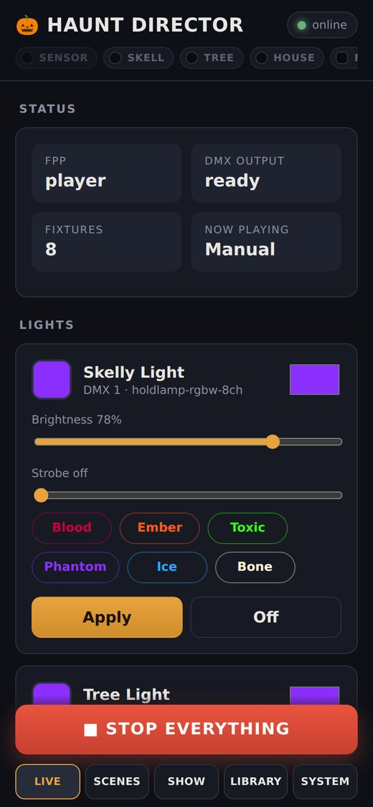
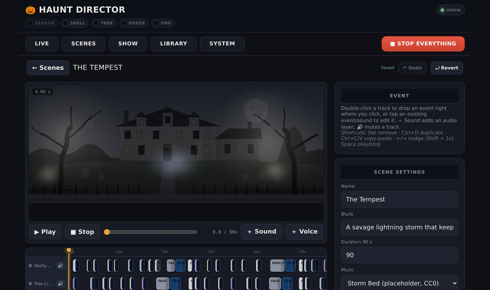
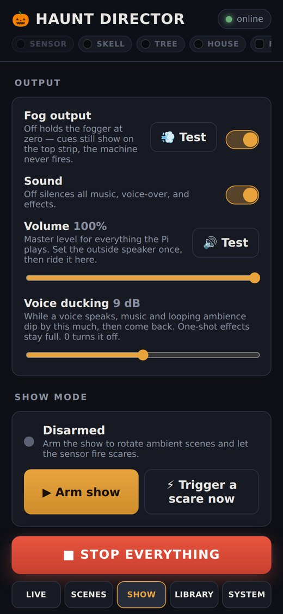
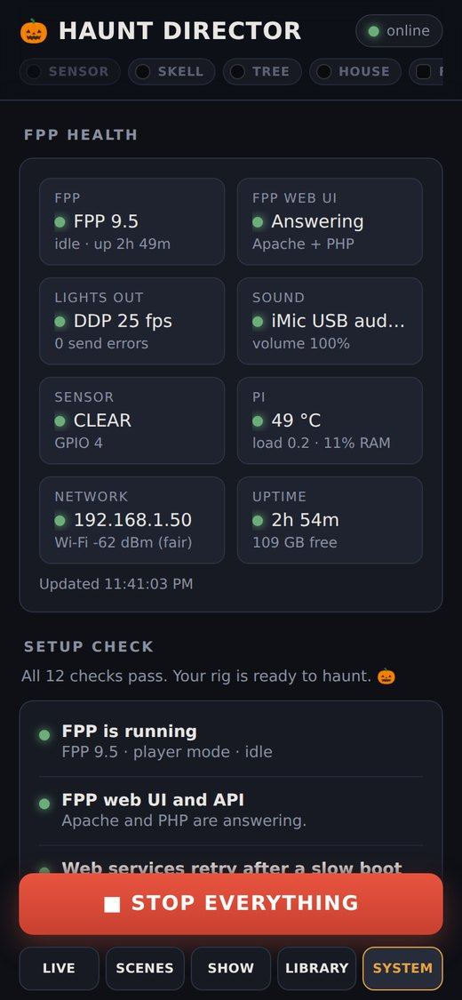

# 🗺️ The tour

Five tabs along the bottom (along the top on a laptop), a status strip across the header, and one very large red button. Here's what everything does.

## The header

- **The signal strip** shows a pill for the sensor, every light and the fogger. Each light's pill glows in the color that fixture is *actually* being sent right now, whether it comes from a scene, a Live card or nothing at all. The sensor pill says CLEAR or PRESENT, and the fog pill lights up whenever fog is being sent.
- **The FPP pill** (top right) is green when FPP is answering. Tap it to jump to the System tab.
- **■ STOP EVERYTHING** is always there. It ends the scene, drops every manual override, cuts sound and zeroes the fogger, all at once.

## 💡 Live

Hands-on control of each fixture, for testing and for "make the porch purple right now" moments.

- Each light card has a color swatch, brightness, a strobe rate and quick presets (*Blood, Ember, Toxic, Phantom, Ice, Bone*). Press **Apply** to send it.
- A light you set here **overrides** the running scene and wears a **Manual** badge. Tap **Release** to hand it back to the scene. Arming the show releases everything automatically.
- The **fog card** fires a burst of a chosen length. Every burst has a hard cap (8 seconds by default) and turns itself off when it's done, even if your phone loses Wi-Fi mid-burst.
- **Yard lights** are for fixtures you can't control (solar spots, battery uplights). Record what they're set to so the simulator matches the yard.

## 🎬 Scenes and the editor

The **Scenes** tab has the **stage**, a simulator that draws your lights and fog over a photo of your house, above the list of scenes. Press **▶ Play** to run a scene on the real rig and the stage at the same time, or **↻ Loop** to keep it going.

Press ✎ on a scene to open the **editor**:

- **One lane per device.** Double-click a lane to drop an event where you clicked, or tap an event to edit it.
- **Event types:** `set_color`, `fade_color`, `set_brightness`, `fade_brightness`, `pulse`, `strobe`, `blackout`, and `fog` on the fogger lane. Fades have curves (linear, ease in, ease out, ease in-out).
- **Sound lanes:** a **music** bed, a **voice-over**, and any number of **layers**. Looping layers are ambient beds (wind, rain); one-shots are hits (thunder, screams). **+ Sound** and **+ Voice** add them at the playhead, and you can **trim** a clip to just the part you want.
- **🔊 on a lane** mutes it while you work, for lights and sound alike.
- **Scene settings:** name, blurb, length, the scene's **role** (*ambient* or *scare*, used by show mode) and how long its sound fades out when the next scene takes over.
- **Shortcuts:** `Del` removes, `Ctrl+D` duplicates (light events land right after the original, sounds at the playhead), `Ctrl+C`/`Ctrl+V` copy and paste, `←`/`→` nudge (hold Shift for 1 s steps), `Space` plays and stops, `Ctrl+Z` undoes.
- It **autosaves**. **Revert** takes you back to how the scene was when you opened it.

The example scenes are a good place to start: *Lightning Storm*, *Zombie Horde*, *Seance* (hundreds of tiny candle-flicker fades) and *The Tempest* (a strobe-heavy scare).

### ✨ Generate (optional, needs your own AI key)

Type something like *"a slow green graveyard mist that builds to a screaming strobe hit at the end"*, pick a length and a **flow** (flat, slow build, build to a strike, waves, cold open), and an AI model drafts the light and fog tracks. Paste a YouTube link and it'll clip a fitting section as the scene's music.

Turn on **🎵 Sync lights to the beat** with a link, and it finds the song's tempo and lands events on the beats instead.

What the model sends back is always **sanitized**: event types and parameters are checked, fog bursts are capped in length and count, and strobe and pulse rates are clamped. Your global strobe cap still applies on top. Everything stays fully editable afterwards. Set `HD_LLM_PROVIDER`, `HD_LLM_API_KEY` and `HD_LLM_MODEL` in `backend/.env` to turn it on. It works with Anthropic or OpenAI keys, and you pay your provider per request.

## 🎃 Show (and Output)

### Output

| Control | What it does |
|---|---|
| **Fog output** | The master fog switch. Off holds the fogger at zero no matter what any scene, card or AI asks for. Cues still show on the signal strip, so you can rehearse fog-free |
| **💨 Test** | A 2-second fog burst through the same capped, self-expiring path as the Live card. Refused while fog output is off |
| **Sound** | Silences all music, voice and effects |
| **Volume** | The master level for everything the Pi plays. It's a perceptual curve, so 50% sounds about half as loud. Set the speaker once, then ride it here |
| **🔊 Test** | A short clip at the current volume |
| **Voice ducking** | While a voice plays, music and looping beds dip by this many dB (default 9), then ease back. One-shot hits stay full so scares keep their punch. 0 turns it off |

### Show mode

**Arm the show** and Haunt Director takes over:

1. It rotates through your **ambient** scenes, crossfading the sound between them.
2. When the **presence sensor** goes HIGH, it picks a random **scare** scene and fires it immediately. Scare audio is loaded into memory when the app starts, so there's no lag. A scene you newly tag as a scare loads on its first trigger, which takes a moment longer.
3. After the scare, it returns to ambient. A trigger that arrives during the **cooldown** waits until the cooldown ends, so one lingering visitor gets at most one scare per cooldown instead of six in a row.

Two switches under the Arm button change how the night runs. Both are saved, so they survive a restart:

- **Sensor fires scares.** Turn it off and the sensor stops firing scares but keeps reading, so the top strip still shows PRESENT and CLEAR (its pill says OFF). Handy while you're working in the yard with the show running, or for a lights-only night. **⚡ Trigger a scare now** still works. The System tab shows a yellow reminder while it's off.
- **Ambient between scares.** Turn it off for a **sensor-only show**: the yard sits dark and quiet, a visitor sets off a scare, and when the scare ends its sound fades out and the yard goes dark again. Arming in this mode starts from a dark, quiet rig too. Lights you set by hand on the Live card after arming are left alone.

Also here:

- **⚡ Trigger a scare now** fires one by hand.
- **Schedule** auto-arms during windows you define. The defaults are a nightly window starting at dusk and a long one for Halloween night. "Dusk" is computed from today's sunset at your **latitude and longitude**, so set those.
- **Presence sensor** sets the GPIO pin and which level means "present". **Remove pin** forgets the pin entirely (to keep it and just stop it firing, use the switch above). **Hold before firing** makes someone stay in range for up to 5 seconds before a scare fires, which filters out a quick pass, a passing car's reflection or a flicker. It's off (0) by default, and 1 to 2 seconds suits a walkway. Range and sensitivity still live in the sensor's own phone app.
- **Scene roles** shows which scenes are in the ambient and scare pools.

## 📚 Library

Every sound you can use in a scene:

- **Upload** a file (wav, mp3, ogg, m4a, flac), or **import from YouTube** with a link (only audio you have the rights to use, please).
- Each clip is filed as **Music**, **Ambience & SFX** or **Voice**. The category matters: clips filed as **Voice** are what trigger voice ducking.
- **Rename, recategorize, preview** or **delete**. Delete warns you if a scene still uses the clip. (Trimming lives in the scene editor.)

The repo ships with five placeholder sounds, synthesized from scratch and dedicated to the public domain (CC0): a dread drone, a wind bed, a storm bed, a thunder crack and a scare stinger. They're there so the example scenes make noise on day one. Swap in better ones!

## 🩺 System

**FPP health** shows live tiles for FPP itself, FPP's web UI, the lights output (frames per second and errors), sound, the sensor, the Pi (temperature, power problems, load), the network (address and Wi-Fi signal) and uptime.

**Setup check** runs about a dozen checks on the things Haunt Director depends on. Most failures come with a one-click **Fix**, and the rest come with a hint. The full list is in [Install, step 4](install.md#4-run-the-setup-check). Fixes that would restart FPP or the app are refused until you disarm the show and stop any playing scene.

**Maintenance** has four buttons, and each one asks twice:

| Button | Effect on the show |
|---|---|
| **↻ Restart FPP web** | None. Restarts Apache and PHP, which is the fix when FPP's UI or API is stuck. DDP light data goes straight to FPP, so the lights keep running |
| **↻ Restart FPP** | Lights drop out for a few seconds, then resume |
| **↻ Restart app** | Lights go dark for a few seconds (the 1-second dead-man switch), then resume. The page reconnects by itself |
| **⏻ Reboot Pi** | Everything goes dark for 1 to 3 minutes. The page waits and reconnects |

**Open FPP's own settings ↗** links to FPP's full web UI for everything this panel doesn't try to do.
